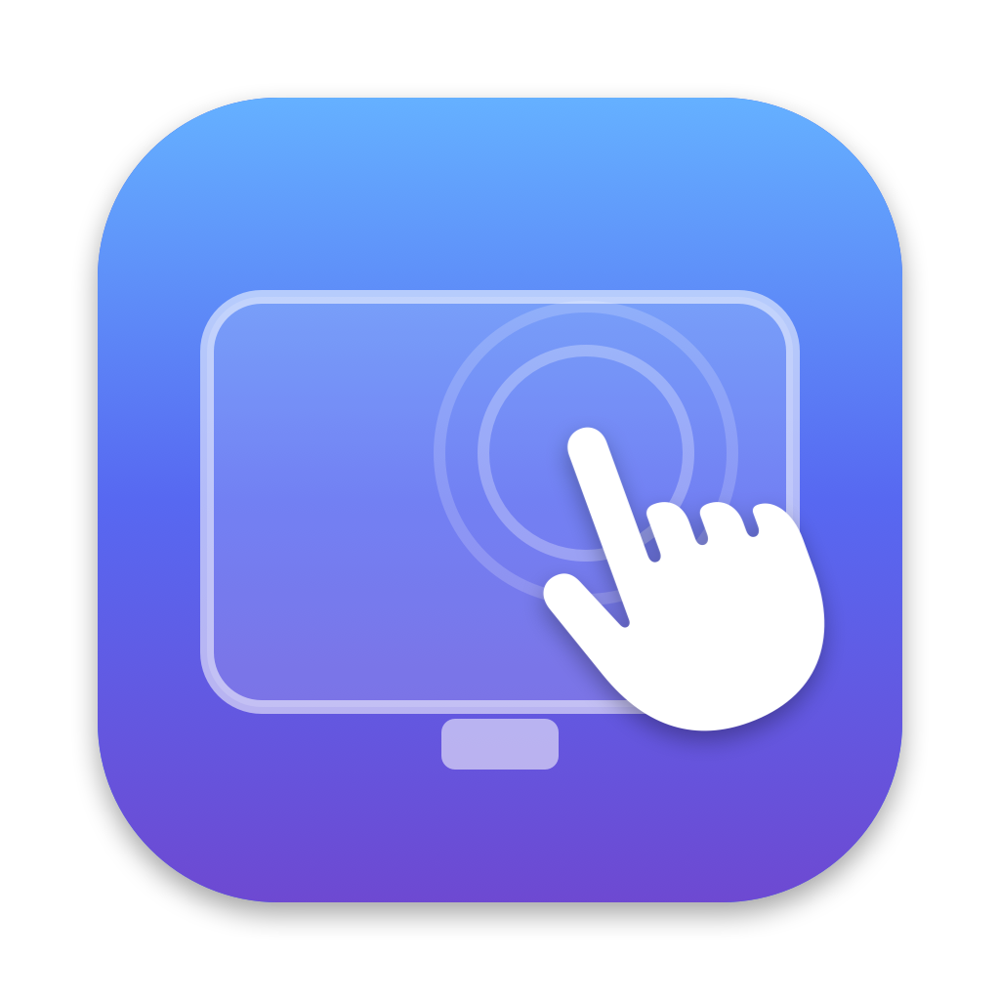

<p align="center"></p>

# TouchBridge

**Trackpad-style multi-touch gestures for USB touch monitors on macOS.**
macOS has no touchscreen support: a USB touch monitor shows up as a mouse, and every finger after
the first is ignored. TouchBridge reads the touch controller directly (all 10 fingers), turns the
touches into the gestures you know from the trackpad and adds a few touch-first features: a
finger-friendly on-screen keyboard mode, a floating dictation button and double-tap video seeking.

Мультитач-жесты трекпада для сенсорных USB-мониторов в macOS. Приложение живёт в строке меню.

---

## Что умеет

| Жест | Действие |
|---|---|
| Тап | клик (двойной/тройной тап — двойной/тройной клик) |
| Провести пальцем | перетаскивание |
| Удержать ~0,6 с и повести | перетаскивание с удержанием (окна, файлы, выделение) |
| Удержать и отпустить, не сдвигая | **правый клик** под пальцем (появляется кольцо-подсказка) |
| Палец на цели + тап вторым рядом | правый клик под первым пальцем |
| Тап двумя пальцами | правый клик (под указательным пальцем, см. `dominantHand`) |
| Два пальца | прокрутка с инерцией, щипок — масштаб, поворот |
| 3–4 пальца | как в **Системных настройках → Трекпад**: ←→ рабочие столы («живая» анимация), ↑ Mission Control, ↓ App Exposé |
| 4–5 пальцев | сведение — Launchpad, разведение — рабочий стол |
| Двойной тап по видео в браузере | слева — назад, справа — вперёд (клавишами самого плеера: YouTube — J/L, иначе ←/→) |

Ещё:

- **Экранная клавиатура** (нативная Accessibility Keyboard) — пункт меню; касания на ней обрабатываются
  в режиме набора: каждый палец — отдельное нажатие, без жестов и задержек.
- **Кнопка диктовки** — плавающий микрофон поверх окон: тап запускает нативную диктовку macOS в поле
  с курсором, во время диктовки кнопка красная с «волнами» (вспыхивают на распознанной речи),
  автоматически останавливается через 3 с после окончания речи. Под кнопкой — язык диктовки (`RU ▾`,
  тап — список языков) и ✕ (убрать кнопку). Кнопку можно перетаскивать.
- Жесты 3–5 пальцами, тап и перетаскивание тремя пальцами берутся из системных настроек трекпада.

## Требования

- macOS 13 Ventura или новее (проверено на macOS 15).
- Xcode / Command Line Tools со Swift 5.9+.
- Сенсорный экран, который отдаёт стандартный HID Digitizer (Touch Screen, usage page 0x0D).
  Проверено на мониторе UPERFECT 22" с контроллером **ILITEK** (`222A:0001`, 10 касаний).

## Сборка и установка

```bash
git clone https://github.com/dkurkaev/TouchBridge.git
cd TouchBridge
./build-app.command
```

Скрипт собирает `TouchBridge.app`, подписывает его (сертификатом Apple Development, если он есть,
иначе ad-hoc), кладёт в `~/Applications` и запускает. С сертификатом разработчика выданные
разрешения сохраняются между пересборками; с ad-hoc-подписью их придётся выдавать заново.

При первом запуске macOS попросит два разрешения для **TouchBridge**:

1. **Мониторинг ввода** — читать сенсорный контроллер;
2. **Универсальный доступ** — отправлять клики, жесты и клавиши.

Пока оба не выданы, TouchBridge не трогает сенсор (иначе тач перестал бы работать совсем). В строке
меню появится значок руки; ⚠️ означает, что не хватает разрешений.

## Меню

- **Выключить / Включить** — отдать сенсор обратно macOS и забрать его.
- **Экранная клавиатура** — показать/скрыть (нужен значок меню ввода в строке меню:
  Системные настройки → Клавиатура → Ввод текста → «Показывать меню ввода в строке меню»).
- **Кнопка диктовки** — показать/скрыть плавающий микрофон.
- **Открыть настройки (config.json)** / **Применить настройки**.
- **Запускать при входе в систему**.
- **Отладка** — лог, подробный лог, проверки синтеза жестов, режим наблюдения сырых касаний.

## Настройки

`~/.config/touchbridge/config.json` (создаётся при первом запуске; после правки — «Применить
настройки»). Отсутствующие ключи берут значения по умолчанию. Основные:

| Ключ | По умолчанию | Что делает |
|---|---|---|
| `displayName` / `displayID` | — | на какой дисплей отображать сенсор (по умолчанию — единственный внешний) |
| `swapXY`, `invertX`, `invertY` | `false` | поворот / зеркалирование координат |
| `featureHandshake` | `true` | запросить у контроллера feature-отчёты, как Windows, — включает мультитач у многих контроллеров |
| `liftGrace` / `liftGraceMulti` | `0.09` / `0.14` | склейка кратких «пропаданий» пальца у контроллера (один палец / несколько) |
| `longPressDelay` | `0.6` | время удержания |
| `holdReleaseAction` | `"rightClick"` | удержание и отпускание без сдвига; `"hold"` — старое «долгое нажатие» |
| `dominantHand` | `"right"` | под какой палец идёт правый клик при одновременном тапе двумя (`"left"` для левшей) |
| `scrollSpeed`, `momentum` | `1.0`, `true` | прокрутка |
| `useSystemGestures` | `true` | брать жесты 3–5 пальцами из настроек трекпада (иначе — ключи `swipe*`, `pinchIn/Out`, `threeFinger*`) |
| `keyboardTypingMode` | `true` | режим набора на экранной клавиатуре |
| `videoDoubleTapSeek` | `true` | двойной тап по видео — перемотка |
| `videoSeekKeys` | `{"youtube.com": "j,l", "default": "left,right"}` | клавиши перемотки по сайтам |

Действия для ключей вроде `twoFingerTap`, `fourFingerTap`, `swipeUp`…: `click`, `rightClick`,
`middleClick`, `doubleClick`, `missionControl`, `appExpose`, `showDesktop`, `launchpad`,
`spaceLeft`, `spaceRight`, `lookup`, `keyboard`, `keys:ctrl+cmd+d`, `open:/path/to/app`, `none`.

Кнопка диктовки: `defaults write local.dkurkaev.TouchBridge dictationSilenceStop -float 3`
(секунд тишины до остановки) и `dictationNoSpeechStop` (если ничего не распознано).

## Как это устроено

- **TouchHID** — `IOHIDManager`, захват сенсора (`kIOHIDOptionsTypeSeizeDevice`), разбор HID-дескриптора
  и отчётов (в т. ч. «гибридный» режим). Интерфейс-мышь контроллера захватывается только после того,
  как дигитайзер реально прислал мультитач, — иначе экран мог бы остаться совсем без тача.
- **ContactDebouncer** — превращает касания контроллера в устойчивые «треки»: склеивает краткие
  пропадания пальцев и заново сопоставляет пальцы по положению, если контроллер их перенумеровал.
- **GestureEngine** — распознавание жестов; **EventSynth** — синтез событий (`CGEvent`), включая
  недокументированные события жестов (масштаб, поворот, «живые» свайпы Dock — как в Mac Mouse Fix).
- **KeyboardTyping**, **VideoTaps**, **Dictation** — режим набора, перемотка видео (через Accessibility
  находит `<video>` под пальцем), кнопка диктовки (нажимает «Правка → Начать диктовку» через
  Accessibility, состояние читает из системного журнала диктовки `log stream`).

## Ограничения

- Масштаб, поворот и «живые» свайпы используют недокументированные события — после обновления
  macOS могут перестать работать (тогда `"swipeMode": "discrete"`).
- Язык диктовки macOS выбирает по раскладке клавиатуры, поэтому выбор языка под кнопкой
  переключает и раскладку.
- Автозамена при наборе с экранной клавиатуры работает так же, как с обычной: только в «родных»
  приложениях macOS (в Chrome и Electron-приложениях её нет).
- Курсор в macOS один: несколько одновременных касаний превращаются в последовательные клики.

## Диагностика

Меню **Отладка → Показать лог** и **Подробный лог** (по умолчанию выключен). Лог: `~/Library/Logs/TouchBridge.log`.
Командная строка (бинарник внутри приложения):

```bash
~/Applications/TouchBridge.app/Contents/MacOS/TouchBridge list -v   # контроллеры, дескрипторы, дисплеи
~/Applications/TouchBridge.app/Contents/MacOS/TouchBridge monitor   # сырые касания
```

Тесты распознавания жестов (кадры касаний проигрываются в реальном времени через движок, события в
систему не отправляются; среди них — реальные записи сбоев контроллера): `Tools/run-gesture-tests.sh`.

Пересобрать иконку: `swift Tools/make-icon.swift`.
